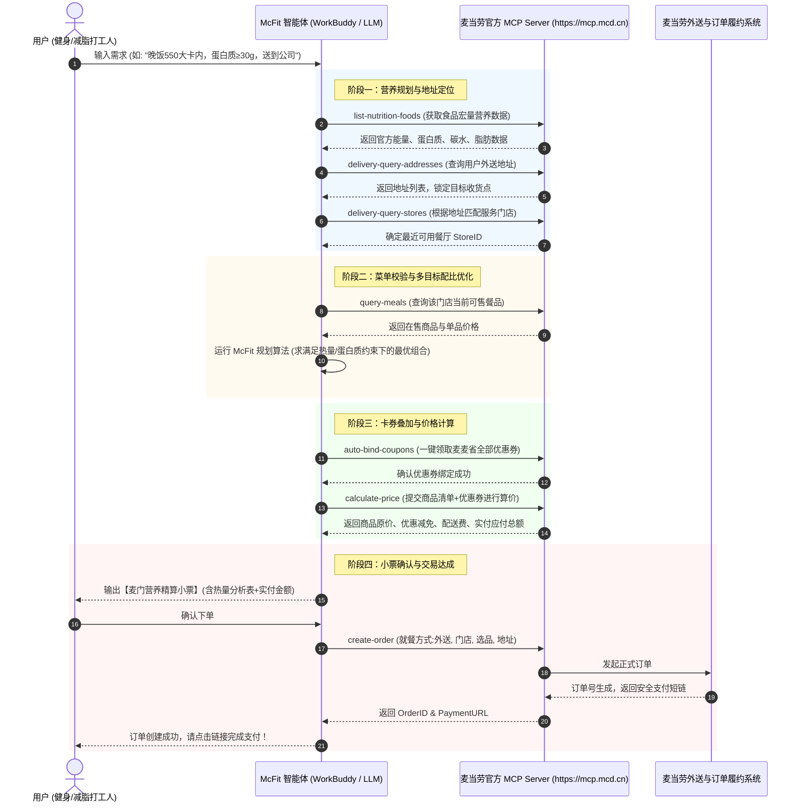

# 麦当劳 MCP 服务接入说明 (MCP Integration Guide)

本项目「McFit 麦当劳卡路里精算师与减脂点餐管家」全面基于**麦当劳中国官方 Model Context Protocol (MCP) Server** 构建。通过大语言模型与 MCP 协议的深度协同，将麦当劳官方食品营养库、动态菜单、优惠券系统与外送履约链路紧密编织为一个面向健康生活与高性价比点餐的智能闭环。

---

## 1. 接入的 MCP Server 说明

- **官方服务名称**：McDonald's China MCP Server
- **协议类型**：`streamablehttp` (Streamable HTTP / SSE)
- **服务 Endpoint**：`https://mcp.mcd.cn`
- **鉴权方式**：`Authorization: Bearer ${MCD_MCP_TOKEN}`
- **官方参考仓库**：[M-China/mcd-mcp-server](https://github.com/M-China/mcd-mcp-server)

---

## 2. 实际调用的 MCP Tools 列表

McFit 在业务链路中按阶段编排调用了麦当劳 MCP 的 8 项核心工具：

| 序号 | Tool 名称 | 中文名称 | 在 McFit 中的应用场景与调用逻辑 |
| :---: | :--- | :--- | :--- |
| 1 | `list-nutrition-foods` | 餐品营养信息列表 | **核心数据源**：获取麦当劳官方餐品的能量（kcal）、蛋白质（g）、脂肪（g）、碳水化合物（g）、钠（mg）等微观与宏量营养成分，作为减脂/增肌算法的基准数据。 |
| 2 | `delivery-query-addresses` | 获取用户可配送地址列表 | **履约预检**：读取用户账号下绑定的历史外送地址（如“家”、“公司前台”），用于快速定位目标收餐点。 |
| 3 | `delivery-query-stores` | 查询可配送的门店列表 | **门店匹配**：依据配送地址精确定位当前处于营业状态且可外送的对应麦当劳餐厅。 |
| 4 | `query-meals` | 查询当前可售卖的餐品列表 | **菜单校验**：避免“推荐了营养搭配但门店断货”，核验当前餐厅可售单品及实时标价。 |
| 5 | `available-coupons` | 麦麦省券列表查询 | **优惠发现**：查询当前用户账户可领取的麦麦省全量限时券包。 |
| 6 | `auto-bind-coupons` | 麦麦省一键领券 | **自动薅羊毛**：在生成订单前自动触发一键领券，确保所有可用折扣券最大化绑定至用户卡包。 |
| 7 | `calculate-price` | 商品价格计算 | **价格精算**：根据拟选购商品清单与卡包优惠券进行模拟算价，计算最优抵扣组合与最终应付金额。 |
| 8 | `create-order` | 创建订单 | **交易闭环**：用户确认营养小票与价格后，一键生成正式外送订单，返回收银台支付链接。 |

---

## 3. 完整业务调用流程 (Workflow & Sequence)

McFit 遵循 **“营养规划 ➔ 门店校验 ➔ 优惠叠加 ➔ 精确算价 ➔ 闭环下单”** 的严谨 pipeline，具体时序如下：

---

## 4. 业务价值与社会效益

1. **破除快餐固有偏见，倡导科学轻饮食生活**：
   - 麦当劳以高标准食材著称，但大众常误以为快餐“必定高热量、不健康”。McFit 通过官方真实数据直观揭示：合理搭配的麦当劳单品（如板烧鸡腿堡、纯牛奶、玉米杯、吉士汉堡）完全可以成为优质、低脂、高蛋白的健身减脂餐。
2. **极速提升点餐决策效率，消除选餐焦虑**：
   - 将繁琐的“查热量 ➔ 找代糖 ➔ 算算卡 ➔ 比对券包 ➔ 手动凑单”流程从原本的 15 分钟压缩至 **一句话 5 秒内完成**。
3. **拉动麦当劳数字化生态券核销与留存**：
   - 主动帮用户调用 `auto-bind-coupons` 并实现券价值最大化匹配，大幅降低卡券过期沉睡率，提升客单粘性与复购率。
